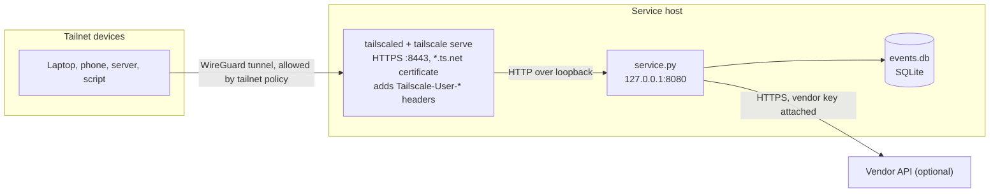

# tailscale-service

A private event hub that only devices on your Tailscale network (tailnet) can reach. It gives you a webhook inbox, a REST API, a live feed, a bulk export and a vendor API gateway, served over HTTPS with a real certificate and caller identity from Tailscale. No port is opened to the internet or to your LAN.

The repository contains:

| File | Purpose |
|---|---|
| `service.py` | The service. Python 3.8+ standard library only. |
| `bench.py` | Measures the service over one or more network paths. Runs on any machine with Python. |
| `check.py` | Self-test. Runs the service and a fake vendor API on loopback and checks every route. No Tailscale needed. |
| `.env.example` | Every setting, with comments. |

There is nothing to `pip install`.

## Contents

1. [Endpoints](#1-endpoints)
2. [Architecture](#2-architecture)
3. [Security model](#3-security-model)
4. [Requirements](#4-requirements)
5. [Evaluate it in five minutes](#5-evaluate-it-in-five-minutes)
6. [Production deployment](#6-production-deployment)
7. [Verify the deployment](#7-verify-the-deployment)
8. [API reference](#8-api-reference)
9. [Sending events](#9-sending-events)
10. [Consuming the live feed](#10-consuming-the-live-feed)
11. [Vendor API gateway](#11-vendor-api-gateway)
12. [Operations](#12-operations)
13. [Performance](#13-performance)
14. [Putting other services behind Tailscale](#14-putting-other-services-behind-tailscale)
15. [Configuration reference](#15-configuration-reference)
16. [Troubleshooting](#16-troubleshooting)
17. [Uninstall](#17-uninstall)

## 1. Endpoints

| Endpoint | Access | Purpose |
|---|---|---|
| `POST /api/events` | Write | Webhook inbox. Backups, cron jobs, CI runs and scripts report what happened. |
| `GET /api/events` | Read | Search and page through events. |
| `GET /api/events/<id>` | Read | One event. |
| `GET /feed` | Read | Live stream of new events (Server-Sent Events), resumable. |
| `GET /api/export` | Read | Every event as NDJSON, for analysis and backups. |
| `GET /upstream/<path>` | Read | Gateway to one vendor API. The vendor key stays on the service host. |
| `GET /whoami` | Read | The identity Tailscale reports for the caller. |
| `GET /healthz` | Read | Liveness check. |

"Read" means any device your tailnet policy allows to reach the service. "Write" additionally requires the write token or a login listed in `WRITERS`. See [section 3](#3-security-model).

## 2. Architecture



1. `service.py` listens on `127.0.0.1:8080`. Nothing outside the host can connect to it.
2. `tailscale serve` accepts HTTPS connections that arrive through the tailnet on port 8443, terminates TLS with a certificate for `<machine>.<tailnet>.ts.net`, and forwards the request to `127.0.0.1:8080`. It adds `Tailscale-User-Login` and `Tailscale-User-Name` headers for the caller and removes any copies the caller sent.
3. Port 8443 exists only inside the tailnet. Devices outside it cannot see it.

## 3. Security model

### Trust boundaries

| Question | Answer | Enforced by |
|---|---|---|
| Who can reach the service? | Tailnet devices that your tailnet policy allows on TCP 8443 of the service host. | Tailscale policy (grants or ACLs) |
| Who can read events, the feed, the export and the gateway? | Everyone who can reach it. | Tailscale policy |
| Who can write events? | Callers with the `SERVICE_TOKEN` bearer token, or callers whose Tailscale login is in `WRITERS`. | `service.py` |
| Who holds secrets? | Only the service host: the write token, the vendor key and `events.db`. | Host file permissions |

The tailnet policy is the read control. If some people on your tailnet should not read events, they must not be able to reach the service.

### Protections built into the service

- **Loopback only.** The default bind address is `127.0.0.1`. Identity headers are only trusted on loopback connections, which is where `tailscale serve` connects from.
- **Constant-time token check** for the bearer token.
- **Cross-site request protection.** `POST /api/events` requires `Content-Type: application/json`. Browsers cannot send that cross-site without a CORS preflight, which the service never approves, so a malicious web page cannot use a `WRITERS` user's browser to post events.
- **DNS rebinding protection.** Loopback requests must carry a `Host` of `127.0.0.1`, `localhost` or a `*.ts.net` name. A web page that rebinds its own domain to `127.0.0.1` gets `421`.
- **Gateway isolation.** The gateway only sends GET requests to the host in `UPSTREAM_URL`, rejects `..` path segments (including percent-encoded ones), never follows redirects, never forwards the caller's `Authorization` header, caps replies at 20 MB, and serves vendor replies with `Content-Security-Policy: sandbox` so vendor content cannot run scripts as the service's origin.
- **Bounded input.** Event bodies are capped at 64 KB and fields are truncated to fixed lengths.
- **Owner-only secrets file.** When `service.py` generates a token it creates `.env` with mode `0600` before writing to it.

### Known limits

Read these before deploying. Each one has a mitigation in [section 6](#6-production-deployment).

- **Local users on the service host are trusted.** Any process on the host can connect to `127.0.0.1:8080`, read every event, and set its own `Tailscale-User-Login` header to write as anyone in `WRITERS`. Run the service on a host where every local account is trusted. Leaving `WRITERS` empty removes the write path; reads remain open to local processes.
- **Tagged devices carry no user identity.** Requests from tagged devices (typical for servers) arrive without `Tailscale-User-Login`. Give those senders the token.
- **Shared devices.** If you share the service host with users outside your tailnet, they can reach the service and their identity headers are populated. Do not list them in `WRITERS` unless they should write.
- **One shared write token.** Every token holder has the same rights, and rotating it means updating every sender.
- **Certificate Transparency.** Enabling HTTPS publishes the machine name and tailnet name in public certificate logs. Nobody can reach the host because of this, but choose a host name that reveals nothing sensitive.
- **No per-request access log.** The service logs startup messages and errors only.
- **Never use Funnel for this service.** `tailscale funnel` publishes to the public internet, and Funnel traffic carries no identity.

## 4. Requirements

| Component | Requirement |
|---|---|
| Tailscale | Installed and logged in on the service host and on every client. MagicDNS and HTTPS certificates enabled for the tailnet. |
| Python | 3.8 or newer on the service host. Clients only need Python to run `bench.py`. |
| Service host | macOS, Linux or Windows. A host that stays on and awake. |
| Permissions | Admin rights on the tailnet to edit the policy and tag devices. Root or administrator on the service host to install it as a system service. |

## 5. Evaluate it in five minutes

This mode is for trying the service on a personal tailnet. It runs in the foreground, generates its own token and publishes itself only while it runs. Use [section 6](#6-production-deployment) for anything long-lived.

1. Install Tailscale on two devices from https://tailscale.com/download and log in with the same account. On Linux run `sudo tailscale up` after installing.
2. Open https://login.tailscale.com/admin/dns. Make sure **MagicDNS** is on and click **Enable** under **HTTPS Certificates**.
3. Linux only: let your user run `tailscale serve` without `sudo`. This gives that user control of the local Tailscale daemon, so only do it on a personal machine.
   ```sh
   sudo tailscale set --operator=$USER
   ```
4. On the service host:
   ```sh
   git clone https://github.com/xorroproprop/tailscale-service
   cd tailscale-service
   python3 service.py --serve --demo-data 2000
   ```
   `--demo-data 2000` adds 2,000 sample events. It adds them on every run that passes it, so use it once.

The service prints something like:

```
created a write token: SERVICE_TOKEN in /home/you/tailscale-service/.env
added 2000 sample events
listening on http://127.0.0.1:8080  (2000 events in /home/you/tailscale-service/events.db)
waiting for the HTTPS certificate (the first time can take up to a minute)...

LIVE on your tailnet: https://box.tail1234.ts.net:8443  (only your tailnet's devices can reach it)
```

From the second device, using the name it printed:

```sh
curl https://box.tail1234.ts.net:8443/whoami
curl "https://box.tail1234.ts.net:8443/api/events?limit=3"
curl -N https://box.tail1234.ts.net:8443/feed
```

Ctrl-C on the service host stops the service and removes the `tailscale serve` rule.

On Windows, type `py` where this guide says `python3`, and `curl.exe` where it says `curl` (in Windows PowerShell 5.1, `curl` is an alias for `Invoke-WebRequest`). On macOS with Python from python.org, run **Install Certificates.command** from the Python folder in Applications once, or Python cannot verify HTTPS certificates.

## 6. Production deployment

The steps below give you a service that starts at boot, runs as an unprivileged account, keeps its secrets out of the code directory, and is reachable only by the people and machines you choose.

### 6.1 Prepare the tailnet

**Enable MagicDNS and HTTPS certificates** at https://login.tailscale.com/admin/dns.

**Name the service host.** Certificate Transparency logs make the name public. In the admin console under **Machines**, rename the host to something neutral such as `hub` before the first certificate is issued.

**Tag the service host.** A tag makes the host owned by the tailnet rather than a person, lets the policy refer to it, and disables node key expiry by default so the service does not drop off the tailnet when a key expires. Define the tags first (next step), then in **Machines**, open the host's menu, choose **Edit ACL tags**, and add `tag:hub`.

**Write the access policy.** Open **Access controls** at https://login.tailscale.com/admin/acls and merge the following into your policy. Adjust the group members.

```json
{
  "groups": {
    "group:hub-users": ["alice@example.com", "bob@example.com"]
  },
  "tagOwners": {
    "tag:hub":        ["autogroup:admin"],
    "tag:hub-sender": ["autogroup:admin"]
  },
  "grants": [
    {
      "src": ["group:hub-users", "tag:hub-sender"],
      "dst": ["tag:hub"],
      "ip":  ["tcp:8443"]
    }
  ],
  "tests": [
    {
      "src": "alice@example.com",
      "accept": ["tag:hub:8443"],
      "deny":   ["tag:hub:8080"]
    }
  ]
}
```

| Part | Effect |
|---|---|
| `group:hub-users` | People who may read the hub. Members listed in `WRITERS` may also write. |
| `tag:hub-sender` | Servers that send events. Tag them in **Machines**. They write with the token. |
| `grants` | Allows only TCP 8443 on the service host, and only from those sources. |
| `tests` | Checked on every policy save. A save that would break these expectations is rejected. |

New tailnets start with a rule that allows all traffic between all devices. A narrower grant next to it changes nothing. Remove or narrow the allow-all rule, keeping any other access you still need, or the service stays reachable by every device.

**Do not enable Funnel** for the service host. If your policy has a `nodeAttrs` entry granting `funnel`, make sure it does not match `tag:hub`.

### 6.2 Prepare the host

- Use a dedicated machine or VM, or at least one where every local account is trusted (see [Known limits](#known-limits)).
- Enable full-disk encryption. `events.db` and the secrets file are plain files.
- Keep the operating system, Python and Tailscale updated.
- Confirm Python 3.8 or newer: `python3 --version`.

### 6.3 Generate the write token

On any machine with Python:

```sh
python3 -c "import secrets; print(secrets.token_hex(32))"
```

Keep it for the next step. Store a copy in your password manager or secrets store so you can configure senders.

### 6.4 Install and run as a system service

Pick the section for the service host's operating system. Each one installs the code where only administrators can change it, stores secrets readable only by the service account, and keeps the database in a separate data directory.

#### Linux (systemd)

From a clone of this repository, create a system account and install the code, owned by root:

```sh
sudo useradd --system --no-create-home --shell /usr/sbin/nologin tailscale-service
sudo install -d -m 0755 /opt/tailscale-service
sudo install -m 0644 service.py /opt/tailscale-service/service.py
```

Do not place a `.env` file in `/opt/tailscale-service`. Settings come from a root-only environment file that systemd reads before dropping privileges:

```sh
sudo install -d -m 0700 /etc/tailscale-service
sudo install -m 0600 /dev/null /etc/tailscale-service/env
sudoedit /etc/tailscale-service/env
```

Contents of `/etc/tailscale-service/env`:

```sh
SERVICE_TOKEN=paste-the-token-from-6.3
DB_PATH=/var/lib/tailscale-service/events.db
WRITERS=alice@example.com
```

Create `/etc/systemd/system/tailscale-service.service`:

```ini
[Unit]
Description=tailscale-service event hub
Wants=network-online.target
After=network-online.target tailscaled.service

[Service]
User=tailscale-service
Group=tailscale-service
ExecStart=/usr/bin/python3 /opt/tailscale-service/service.py
EnvironmentFile=/etc/tailscale-service/env
Environment=PYTHONUNBUFFERED=1
StateDirectory=tailscale-service
StateDirectoryMode=0700
UMask=0077
Restart=on-failure
RestartSec=5

# Sandboxing
NoNewPrivileges=yes
CapabilityBoundingSet=
ProtectSystem=strict
ProtectHome=yes
PrivateTmp=yes
PrivateDevices=yes
ProtectKernelTunables=yes
ProtectKernelModules=yes
ProtectControlGroups=yes
RestrictAddressFamilies=AF_INET AF_INET6 AF_UNIX
RestrictNamespaces=yes
LockPersonality=yes
SystemCallArchitectures=native

[Install]
WantedBy=multi-user.target
```

`StateDirectory` creates `/var/lib/tailscale-service` owned by the service account. `ProtectSystem=strict` makes the rest of the file system read-only to the service.

Start it, then publish it to the tailnet. `--bg` keeps the publish rule across reboots.

```sh
sudo systemctl daemon-reload
sudo systemctl enable --now tailscale-service
sudo tailscale serve --bg --https=8443 http://127.0.0.1:8080
journalctl -u tailscale-service -f
systemd-analyze security tailscale-service
```

#### macOS (launchd)

The macOS Tailscale app runs while a user is logged in, so the service runs as a LaunchAgent for that user. Keep the folder outside Desktop, Documents and Downloads, which macOS privacy controls block for background jobs.

```sh
git clone https://github.com/xorroproprop/tailscale-service ~/tailscale-service
cd ~/tailscale-service
touch .env && chmod 600 .env
nano .env
```

Contents of `~/tailscale-service/.env`:

```sh
SERVICE_TOKEN=paste-the-token-from-6.3
WRITERS=alice@example.com
```

Create `~/Library/LaunchAgents/local.tailscale-service.plist`. Replace `/opt/homebrew/bin/python3` with the output of `which python3`, and `you` with your user name.

```xml
<?xml version="1.0" encoding="UTF-8"?>
<!DOCTYPE plist PUBLIC "-//Apple//DTD PLIST 1.0//EN" "http://www.apple.com/DTDs/PropertyList-1.0.dtd">
<plist version="1.0">
<dict>
  <key>Label</key><string>local.tailscale-service</string>
  <key>ProgramArguments</key>
  <array>
    <string>/opt/homebrew/bin/python3</string>
    <string>/Users/you/tailscale-service/service.py</string>
  </array>
  <key>EnvironmentVariables</key>
  <dict><key>PYTHONUNBUFFERED</key><string>1</string></dict>
  <key>StandardOutPath</key><string>/Users/you/Library/Logs/tailscale-service.log</string>
  <key>StandardErrorPath</key><string>/Users/you/Library/Logs/tailscale-service.log</string>
  <key>RunAtLoad</key><true/>
  <key>KeepAlive</key><true/>
</dict>
</plist>
```

Load it and publish:

```sh
launchctl bootstrap gui/$(id -u) ~/Library/LaunchAgents/local.tailscale-service.plist
/Applications/Tailscale.app/Contents/MacOS/Tailscale serve --bg --https=8443 http://127.0.0.1:8080
```

In **System Settings**, turn off sleep for the host, or it disappears from the tailnet when it sleeps.

#### Windows (Task Scheduler)

Run these in an administrator PowerShell. Python must be installed for all users so the service account can run it:

```powershell
winget install Python.Python.3.12 --scope machine
```

Install the code under Program Files, where only administrators can write. Folders created directly under `C:\` are writable by every signed-in user, so avoid them.

```powershell
$dir  = "C:\Program Files\tailscale-service"
$data = "C:\ProgramData\tailscale-service"
New-Item -ItemType Directory -Force $dir, $data | Out-Null
Copy-Item .\service.py $dir

$token = py -c "import secrets; print(secrets.token_hex(32))"
Set-Content -Path "$dir\.env" -Encoding ascii -Value "SERVICE_TOKEN=$token", "DB_PATH=$data\events.db", "WRITERS=alice@example.com"

# .env: Administrators and SYSTEM full control, LOCAL SERVICE read, nobody else
icacls "$dir\.env" /inheritance:r /grant:r "*S-1-5-32-544:F" "*S-1-5-18:F" "*S-1-5-19:R"
# data folder: LOCAL SERVICE may create and modify the database
icacls $data /grant "*S-1-5-19:(OI)(CI)M"
```

Register a task that starts at boot as the built-in `LOCAL SERVICE` account, with no run time limit and automatic restarts:

```powershell
$python    = "C:\Program Files\Python312\python.exe"
$action    = New-ScheduledTaskAction -Execute $python -Argument "`"$dir\service.py`""
$trigger   = New-ScheduledTaskTrigger -AtStartup
$principal = New-ScheduledTaskPrincipal -UserId "LOCALSERVICE" -LogonType ServiceAccount
$settings  = New-ScheduledTaskSettingsSet -ExecutionTimeLimit ([TimeSpan]::Zero) -RestartCount 999 -RestartInterval (New-TimeSpan -Minutes 1)
Register-ScheduledTask -TaskName "tailscale-service" -Action $action -Trigger $trigger -Principal $principal -Settings $settings
Start-ScheduledTask -TaskName "tailscale-service"

tailscale serve --bg --https=8443 http://127.0.0.1:8080
```

Without `-ExecutionTimeLimit ([TimeSpan]::Zero)`, Task Scheduler stops the task after 72 hours.

Write `$token` to your secrets store before closing the window, then clear it with `Remove-Variable token`.

## 7. Verify the deployment

Run these checks after every deployment or policy change. Replace `hub.tail1234.ts.net` with your host's name.

**The service listens on loopback only.** On the service host, the local address must be `127.0.0.1:8080`, never `0.0.0.0` or `*`:

```sh
ss -ltn 'sport = :8080'                          # Linux
lsof -nP -iTCP:8080 -sTCP:LISTEN                 # macOS
Get-NetTCPConnection -LocalPort 8080 -State Listen   # Windows PowerShell
```

**Only the intended rule is published, and nothing is public:**

```sh
tailscale serve status
tailscale funnel status
```

**An allowed user gets an identity:**

```sh
curl https://hub.tail1234.ts.net:8443/whoami
```
```json
{"via_tailscale_serve": true, "login": "alice@example.com", "name": "Alice", "ip": "100.101.102.104", "can_write": true}
```

**Writes without credentials are refused** (run as a user not in `WRITERS`):

```sh
curl -s -o /dev/null -w "%{http_code}\n" -X POST https://hub.tail1234.ts.net:8443/api/events \
  -H "Content-Type: application/json" -d '{"type": "probe"}'
# 401
```

**A write with the token succeeds:**

```sh
read -rs SERVICE_TOKEN && export SERVICE_TOKEN   # paste the token; it is not echoed or saved in shell history
curl -X POST https://hub.tail1234.ts.net:8443/api/events \
  -H "Authorization: Bearer $SERVICE_TOKEN" -H "Content-Type: application/json" \
  -d '{"type": "deploy.verified", "message": "first event"}'
# {"id": 1}
```

**Devices outside the policy cannot connect.** From a tailnet device not in `group:hub-users`, the request must time out. From a LAN device without Tailscale, `http://<host-lan-ip>:8080/healthz` must be refused.

**The self-test passes** on the code you deployed:

```sh
python3 check.py
```

## 8. API reference

Base URL: `https://<machine>.<tailnet>.ts.net:8443`. Replies are JSON unless noted.

### The event object

```json
{
  "id": 200001,
  "at": "2026-10-14T02:09:55.369Z",
  "source": "nas",
  "type": "backup.finished",
  "message": "nightly backup finished",
  "data": {"gb": 12, "duration_s": 340}
}
```

| Field | Description |
|---|---|
| `id` | Increasing integer. Also the cursor for paging and for resuming the feed. |
| `at` | When the hub received the event, UTC. |
| `source` | Sender. Defaults to the caller's Tailscale login, else their tailnet IP. |
| `type` | What happened, for example `backup.finished`, `job.failed`, `deploy`. Keep names stable. |
| `message` | One human-readable line. |
| `data` | Any JSON object or array. |

### `POST /api/events`

Requires write access and `Content-Type: application/json`. Body: a JSON object with `type` (required, up to 100 characters) and optionally `message` (up to 2000), `source` (up to 100) and `data`. Longer strings are truncated. Maximum body size is 64 KB.

| Status | Meaning |
|---|---|
| `201 {"id": 123}` | Stored and delivered to every live feed subscriber. |
| `400` | Not a JSON object, or no `type`. |
| `401` | No valid `Authorization: Bearer <SERVICE_TOKEN>`, and the caller is not in `WRITERS`. |
| `411` / `413` | Missing `Content-Length`, or body over 64 KB. |
| `415` | `Content-Type` is not `application/json`. |

### `GET /api/events`

| Parameter | Description |
|---|---|
| `limit` | 1 to 500, default 50. |
| `type` | Exact match, for example `type=job.failed`. |
| `source` | Exact match, for example `source=nas`. |
| `q` | Substring search in `message` and `data`. |
| `before` | Only ids below this value. For paging back through history. |
| `after` | Only ids above this value, returned oldest first. For catching up. |

Reply: `{"items": [...], "cursor": <id of the last item, or null>}`. Newest first unless `after` is given.

```sh
# the 20 most recent failures
curl "https://hub.tail1234.ts.net:8443/api/events?type=job.failed&limit=20"
# the next page back: pass the cursor as before=
curl "https://hub.tail1234.ts.net:8443/api/events?type=job.failed&limit=20&before=199871"
# everything since the last event you saw: pass the cursor as after=
curl "https://hub.tail1234.ts.net:8443/api/events?after=200001"
```

### `GET /api/events/<id>`

One event, or `404`.

### `GET /feed`

A [Server-Sent Events](https://developer.mozilla.org/docs/Web/API/Server-sent_events) stream. Each event arrives as:

```
id: 200002
data: {"id": 200002, "at": "...", "source": "nas", "type": "backup.finished", "message": "...", "data": {...}}

```

- By default the stream starts at the moment you connect.
- `?after=<id>` replays everything after that id, then continues live. `?after=0` replays all events.
- The `Last-Event-ID` request header does the same. Standard SSE clients send it when they reconnect, so no event is missed across a reconnect.
- Lines starting with `:` are comments (`: connected`, and `: keep-alive` every 15 seconds). Ignore them.

### `GET /api/export`

Every event as NDJSON, one JSON object per line, oldest first. The export is built in memory and reused until a new event arrives.

```sh
curl -o events.ndjson https://hub.tail1234.ts.net:8443/api/export
jq -c 'select(.type == "job.failed")' events.ndjson
duckdb -c "SELECT type, count(*) FROM read_json_auto('events.ndjson') GROUP BY type"
python3 -c "import pandas as pd; print(pd.read_json('events.ndjson', lines=True).type.value_counts())"
```

### `GET /upstream/<path>`

See [section 11](#11-vendor-api-gateway).

### `GET /whoami` and `GET /healthz`

`/whoami` returns `via_tailscale_serve`, `login`, `name`, `ip` and `can_write`. `/healthz` returns `{"ok": true}`.

### Other status codes

| Status | Meaning |
|---|---|
| `421` | A loopback request carried a `Host` other than `127.0.0.1`, `localhost` or `*.ts.net`. |
| `404` | Unknown path. |

## 9. Sending events

Guidelines for any sender:

- **Fail open.** Use a short timeout (5 seconds) and ignore errors, so a restarting hub never fails a backup or deploy.
- **Never disable certificate verification** (`-k`, `verify=False`, `-SkipCertificateCheck`). Use the `ts.net` name, not the `100.x` address; the certificate only covers the name.
- **Keep secrets out of events.** Every reader of the hub can see them.
- **Load the token from the environment or a protected file,** never from the script source.
- **Always send `Content-Type: application/json`.** Requests without it get `415`.

People in `WRITERS` can post without a token from their own devices. Servers, CI runners and other tagged devices must use the token.

**Shell and cron** (Linux, macOS):

```sh
notify() {  # notify <type> <message>
  curl -sS --max-time 5 -X POST "https://hub.tail1234.ts.net:8443/api/events" \
    -H "Authorization: Bearer $SERVICE_TOKEN" -H "Content-Type: application/json" \
    -d "{\"type\": \"$1\", \"source\": \"$(hostname)\", \"message\": \"$2\"}" >/dev/null || true
}
```

This builds JSON by string substitution, so pass only simple messages without quotes or backslashes. Use the Python helper for anything else.

**Python** (standard library):

```python
import json, os, socket, urllib.request

def notify(type_, message="", data=None):
    """Push one event to the hub. Never raises; gives up after 5 seconds."""
    body = {"type": type_, "source": socket.gethostname(), "message": message, "data": data or {}}
    req = urllib.request.Request(
        os.environ.get("HUB_URL", "https://hub.tail1234.ts.net:8443") + "/api/events",
        data=json.dumps(body).encode(),
        headers={"Authorization": "Bearer " + os.environ["SERVICE_TOKEN"], "Content-Type": "application/json"})
    try:
        urllib.request.urlopen(req, timeout=5).close()
    except Exception as e:
        print("notify skipped:", e)

notify("etl.finished", "loaded orders", {"rows": 81234, "seconds": 42})
```

**PowerShell** (Windows):

```powershell
function Send-HubEvent([string]$Type, [string]$Message = "", $Data = @{}) {
    try {
        $body = @{ type = $Type; source = $env:COMPUTERNAME; message = $Message; data = $Data } | ConvertTo-Json -Depth 8 -Compress
        Invoke-RestMethod -Method Post -Uri "https://hub.tail1234.ts.net:8443/api/events" -TimeoutSec 5 `
            -Headers @{ Authorization = "Bearer $env:SERVICE_TOKEN" } -ContentType "application/json; charset=utf-8" `
            -Body ([Text.Encoding]::UTF8.GetBytes($body)) | Out-Null
    } catch { Write-Warning "Send-HubEvent skipped: $_" }
}

Send-HubEvent -Type "backup.finished" -Message "D: to NAS" -Data @{ gb = 12 }
```

**Node.js** 18 or newer:

```js
async function notify(type, message = "", data = {}) {
  try {
    await fetch("https://hub.tail1234.ts.net:8443/api/events", {
      method: "POST",
      headers: { Authorization: `Bearer ${process.env.SERVICE_TOKEN}`, "Content-Type": "application/json" },
      body: JSON.stringify({ type, message, data }),
      signal: AbortSignal.timeout(5000),
    });
  } catch (e) { console.warn("notify skipped:", e.message); }
}
```

## 10. Consuming the live feed

**Terminal:**

```sh
curl -N https://hub.tail1234.ts.net:8443/feed            # from now on
curl -N "https://hub.tail1234.ts.net:8443/feed?after=0"  # everything, then live
```

**Python**, reconnecting indefinitely without missing events:

```python
import http.client, json, time

HOST, PORT = "hub.tail1234.ts.net", 8443
last = None   # id of the last event handled

while True:
    try:
        conn = http.client.HTTPSConnection(HOST, PORT, timeout=60)   # keep-alives arrive every 15 s
        conn.request("GET", "/feed", headers={"Last-Event-ID": last} if last else {})
        resp = conn.getresponse()
        for line in iter(resp.readline, b""):
            if line.startswith(b"id:"):
                last = line[3:].strip().decode()
            elif line.startswith(b"data:"):
                event = json.loads(line[5:])
                if event["type"].endswith(".failed"):
                    print("ALERT:", event["source"], event["message"])
    except OSError as e:
        print("feed dropped, reconnecting:", e)
    time.sleep(2)
```

Replace the `print` with a call to your chat or paging webhook to get an alerting bot.

**Node.js** 18 or newer:

```js
// save as feed.mjs, run with: node feed.mjs
const res = await fetch("https://hub.tail1234.ts.net:8443/feed");
const decoder = new TextDecoder();
for await (const chunk of res.body) process.stdout.write(decoder.decode(chunk, { stream: true }));
```

**Polling.** Clients that cannot hold a connection open can remember the last `cursor` and request `GET /api/events?after=<cursor>` on a schedule.

## 11. Vendor API gateway

Many vendors issue one API key with a shared quota. Copying it to every laptop and script makes it likely to leak, hard to rotate, and wasteful of quota. The gateway keeps the key on the service host. Tailnet clients call `GET /upstream/<path>`; the service adds the key, calls the vendor and returns the reply. Successful replies are cached and shared.

### Configure

Add the vendor to the service's settings (the environment file on Linux, `.env` elsewhere) and restart the service:

```sh
UPSTREAM_URL=https://api.vendor.example/v1     # vendor base URL
UPSTREAM_HEADER=X-API-Key                      # header that carries the key
UPSTREAM_KEY=your-secret-key                   # full header value
UPSTREAM_CACHE_SECONDS=300                     # reuse 200 replies for 5 minutes; 0 disables the cache
```

Then from any allowed tailnet device:

```sh
curl "https://hub.tail1234.ts.net:8443/upstream/ip/203.0.113.9"
# the service requests GET https://api.vendor.example/v1/ip/203.0.113.9 with X-API-Key: your-secret-key
```

| Vendor documentation says | `UPSTREAM_HEADER` | `UPSTREAM_KEY` |
|---|---|---|
| `Authorization: Bearer <key>` | `Authorization` | `Bearer <key>` |
| `Authorization: Token <key>` | `Authorization` | `Token <key>` |
| `X-API-Key: <key>` or another custom header | that header's name | `<key>` |
| `?api_key=<key>` in the URL | Not supported. Keys in URLs end up in logs. | |

### Example without a key: GitHub's public API

```sh
UPSTREAM_URL=https://api.github.com
UPSTREAM_CACHE_SECONDS=300
# optional, for higher rate limits:
# UPSTREAM_KEY=Bearer github_pat_...
```

```sh
curl -i https://hub.tail1234.ts.net:8443/upstream/repos/tailscale/tailscale   # X-Cache: miss
curl -i https://hub.tail1234.ts.net:8443/upstream/repos/tailscale/tailscale   # X-Cache: hit
```

### Rules and limits

- Every client that can reach the service can use the key. Scope the vendor key to the minimum permissions the vendor allows, preferably read-only.
- GET only, and only to the host in `UPSTREAM_URL`. Clients choose the path and query, never the host.
- Redirects are not followed, so the key is never sent elsewhere.
- The client's own `Authorization` header is never forwarded.
- Replies over 20 MB are refused with `502`. Vendor errors such as `404` and `429` are passed through.
- Only `200` replies are cached, keyed by full URL, and shared by all clients. Do not proxy per-user data, or set `UPSTREAM_CACHE_SECONDS=0`.
- One instance serves one vendor. For more vendors, run more instances with separate settings, data paths and ports (`--port 8081`, and publish them on another HTTPS port such as 8444).

## 12. Operations

### Monitoring

Point an uptime checker on the tailnet at `https://<host>:8443/healthz`. It returns `200 {"ok": true}` while the service and `tailscale serve` are both working.

Service output goes to `journalctl -u tailscale-service` on Linux, `~/Library/Logs/tailscale-service.log` on macOS, and Task Scheduler history on Windows.

### Backups

A logical backup from any allowed tailnet device, safe while the service runs:

```sh
curl -fsS -o "events-$(date +%F).ndjson" https://hub.tail1234.ts.net:8443/api/export
```

A consistent copy of the database file, on the service host while it runs (Linux paths shown):

```sh
sudo -u tailscale-service python3 -c "import sqlite3; sqlite3.connect('/var/lib/tailscale-service/events.db').backup(sqlite3.connect('/var/lib/tailscale-service/backup.db'))"
sudo mv /var/lib/tailscale-service/backup.db /secure/backups/events-$(date +%F).db
```

Backups contain every event. Store them encrypted, with the same access controls as the host.

### Retention

The service keeps every event. To prune, run as the service account (Linux paths shown), then restart the service so the cached export is rebuilt:

```sh
sudo -u tailscale-service python3 -c "import sqlite3; c = sqlite3.connect('/var/lib/tailscale-service/events.db'); c.execute(\"DELETE FROM events WHERE at < '2026-01-01'\"); c.commit()"
sudo systemctl restart tailscale-service
```

### Rotating the write token

1. Generate a new token ([section 6.3](#63-generate-the-write-token)).
2. Replace `SERVICE_TOKEN` in the service's settings and restart the service.
3. Update every sender. Events sent with the old token are rejected with `401` until the sender is updated.

Rotate immediately if the token may have leaked, and whenever someone with access to it leaves.

### Rotating the vendor key

Issue a new key at the vendor, replace `UPSTREAM_KEY`, restart the service, then revoke the old key at the vendor. Clients need no change.

### Upgrading

Replace `service.py` with the new version, run `python3 check.py` from the new checkout, and restart the service. On macOS, `git pull` in `~/tailscale-service`; on Linux and Windows, copy the file again with the install commands from [section 6.4](#64-install-and-run-as-a-system-service). The database schema is created on startup if missing and is otherwise left unchanged.

### Capacity

The service is a single process. Each open feed connection holds one thread, which suits dozens of subscribers. The export is built in memory, which suits databases up to a few hundred megabytes. Beyond that, use the paged API instead of the export.

## 13. Performance

### Running the benchmark

```sh
python3 bench.py https://hub.tail1234.ts.net:8443
```

For each URL, over one keep-alive connection:

| Column | Meaning |
|---|---|
| `route` | `direct` (peer to peer) or `relay:<region>` (through a Tailscale DERP relay), from `tailscale ping`. |
| `link rtt` | Round trip of the network between the two devices. This is the floor. |
| `connect` | TCP setup plus the TLS handshake. Paid once per connection. |
| `tiny p50` | A 12-byte request. `tiny p50` minus `link rtt` is the per-request cost of Tailscale, TLS and the service. |
| `api p50 / p95 / p99` | A typical API call (`/api/events?limit=20`, about 3 KB). |
| `feed p50` | Time from publishing an event to receiving it on the live feed. Needs write access: `SERVICE_TOKEN` in the environment or in a `.env` next to `bench.py`, or your login in `WRITERS`. |
| `export` | Download speed of `/api/export`, median of 3. |
| `tailscale identity` | The login the service saw. Only the `tailscale serve` path has one. |

The benchmark posts 50 events of type `bench` per URL. `--feed 0` skips that. Run it against a test instance, not production data.

### Comparing against a path without Tailscale

On a test instance on a LAN, you can measure the same service over three paths. On the service host, for the duration of the test only:

```sh
python3 service.py --serve --bind 0.0.0.0
```

This exposes the service on the LAN without authentication for reads. The service prints a ready-made command for a client on the same LAN:

```sh
python3 bench.py http://192.168.1.20:8080 http://100.101.102.103:8080 https://hub.tail1234.ts.net:8443
```

| URL | Path |
|---|---|
| `http://<lan-ip>:8080` | Baseline: an open port, no encryption, no identity. |
| `http://<100.x>:8080` | Through the WireGuard tunnel only. |
| `https://<name>.ts.net:8443` | The production path: tunnel, HTTPS, identity, backend on loopback. |

The first URL is the baseline, and `bench.py` reports the others relative to it. Restart without `--bind` as soon as you are done.

Across the internet there is usually no comparable path without opening a port. Compare `tiny p50` to `link rtt` instead.

### What affects speed

- **Relayed connections.** If `route` shows `relay:<region>`, traffic goes through a relay and both latency and throughput suffer. This happens when both sides are behind strict NAT or firewalls. `tailscale netcheck` shows the cause. Allowing outbound UDP, or opening UDP 41641 on one side, usually restores a direct connection.
- **New connections** pay one extra round trip for the TLS handshake. Clients that reuse connections (browsers, `requests.Session`, `http.client`, `fetch`) pay it once.
- **Very fast LANs.** `tailscale serve` terminates TLS in user space. On the author's Mac, one stream through it peaked around 800 Mb/s: well above typical internet uplinks, below 10 Gb/s LANs.
- **Small CPUs** such as older single-board computers and NAS devices can be limited by encryption. Compare the `100.x` row with the LAN row.

### Reference measurements

Measured on 2026-10-13. Service on a Mac on Wi-Fi, client on a Windows PC at a different site, connected directly by Tailscale about 35 ms apart.

| Measurement | Result |
|---|---|
| Per-request cost on the same machine (`tailscale serve` with HTTPS vs. plain loopback HTTP) | +0.24 ms |
| Per-request cost across sites (`tiny p50` vs. `link rtt`) | Between -3 and +4 ms over five runs, within the link's own variation (link p95 was 88 ms) |
| Live feed delivery across sites, p50 | 38 ms, about one link round trip |
| Export download across sites | 33 to 35 Mb/s, limited by the Mac's 42 Mb/s upload |

## 14. Putting other services behind Tailscale

The same pattern works for any service:

1. **Listen on `127.0.0.1`**, never `0.0.0.0`.
2. **Publish with `tailscale serve`:**

```sh
tailscale serve --bg --https=443 http://127.0.0.1:9000   # https://<machine>.<tailnet>.ts.net
tailscale serve status                                   # list published rules
tailscale serve --https=443 off                          # remove one rule
```

Use a different HTTPS port for each service, and add each port to your tailnet policy.

| Stack | Listen on loopback |
|---|---|
| Flask | `flask run --host 127.0.0.1 --port 9000` |
| FastAPI | `uvicorn app:app --host 127.0.0.1 --port 9000` |
| Django | `python manage.py runserver 127.0.0.1:9000`, with your `ts.net` name in `ALLOWED_HOSTS` |
| Express | `app.listen(9000, "127.0.0.1")` |
| Go | `http.ListenAndServe("127.0.0.1:9000", mux)` |
| ASP.NET | `dotnet run --urls http://127.0.0.1:9000` |
| Static files | `python3 -m http.server 9000 --bind 127.0.0.1 --directory ./reports` |

If your service uses the `Tailscale-User-Login` header for authorization, trust it only on loopback connections, and apply the same cross-site and DNS rebinding protections described in [section 3](#protections-built-into-the-service). See `Handler.identity()` and `Handler.parse_request()` in `service.py`.

**Docker.** Publish container ports on loopback only:

```sh
docker run -d -p 127.0.0.1:9000:9000 my-api
```
```yaml
services:
  api:
    image: my-api
    ports:
      - "127.0.0.1:9000:9000"
```

`-p 9000:9000` without the address listens on every interface, and on Linux Docker's rules bypass host firewalls such as `ufw`. To give a container its own tailnet identity instead, see https://tailscale.com/kb/1282/docker.

**Databases and other TCP services.** `tailscale serve` also forwards raw TCP:

```sh
tailscale serve --bg --tcp=5432 tcp://127.0.0.1:5432
```

Keep the database's own authentication. Tailscale decides who can reach it; the database decides who can log in.

## 15. Configuration reference

Settings are read from environment variables, then from a `.env` file next to `service.py`. Environment variables take precedence. Restart the service after changes. `.env.example` documents every setting.

| Setting | Default | Description |
|---|---|---|
| `SERVICE_TOKEN` | Generated into `.env` on first run if unset | Bearer token for `POST /api/events`. Set it explicitly in production. |
| `WRITERS` | Empty | Comma-separated Tailscale logins that may write without the token. Case-insensitive. Find a login with `/whoami`. |
| `UPSTREAM_URL` | Empty (gateway off) | Vendor API base URL. |
| `UPSTREAM_HEADER` | `Authorization` | Header that carries the vendor key. |
| `UPSTREAM_KEY` | Empty | Full header value, for example `Bearer abc123`. |
| `UPSTREAM_CACHE_SECONDS` | `60` | Lifetime of cached `200` replies. `0` disables the cache. |
| `DB_PATH` | `events.db` next to `service.py` | SQLite database path. The directory must be writable by the service. |

| Flag | Default | Description |
|---|---|---|
| `--serve` | Off | Publish with `tailscale serve` while running, and remove the rule on exit. For evaluation. |
| `--port` | `8080` | Local port. |
| `--https-port` | `8443` | Tailnet HTTPS port used by `--serve`. |
| `--bind` | `127.0.0.1` | Do not change in production. `0.0.0.0` exists only for the benchmark baseline. |
| `--demo-data N` | `0` | Add N sample events at startup. |

## 16. Troubleshooting

| Symptom | Cause and fix |
|---|---|
| `Tailscale's command line tool wasn't found` | Install Tailscale. On Windows, open a new terminal after installing. |
| `Tailscale isn't connected` | Log in with the Tailscale app, or `sudo tailscale up` on Linux. |
| `This machine has no MagicDNS name` | Enable MagicDNS at https://login.tailscale.com/admin/dns. |
| `serve config denied` or `Access denied` on Linux | Run `tailscale serve` with `sudo`, or on a personal machine `sudo tailscale set --operator=$USER`. |
| Startup waits for the certificate, then gives up | Enable HTTPS Certificates at https://login.tailscale.com/admin/dns. The first certificate can take a minute. |
| `tailscale serve stopped ... port already taken` | Another rule uses that HTTPS port. Check `tailscale serve status` and choose another with `--https-port`. |
| `address already in use` | Another program uses local port 8080. Use `--port 8081` and publish that port. |
| `PermissionError` reading `.env` at startup | The service account cannot read `.env`. Fix its permissions, or on Linux remove it and use the systemd environment file. |
| `PermissionError` or `unable to open database file` | The service account cannot write the directory in `DB_PATH`. |
| `CERTIFICATE_VERIFY_FAILED` | You used the `100.x` address over HTTPS (use the `ts.net` name), or python.org Python on macOS is missing **Install Certificates.command**. |
| Connection times out | The host is offline or asleep (`tailscale status`), the service is stopped, or the tailnet policy does not allow you on port 8443. |
| `502 Bad Gateway` | `tailscale serve` is running but the service is not, or it listens on a different port. |
| `401` on POST | Wrong or missing token, or your login is not in `WRITERS`. Requests from tagged devices always need the token. |
| `415` on POST | Add `-H "Content-Type: application/json"`. |
| `421` | A loopback client sent an unexpected `Host` header. Use `127.0.0.1`, `localhost` or the `ts.net` name. |
| The feed shows nothing | It starts at the moment you connect. Post an event, or use `?after=0`. |
| `route` shows `relay:<region>` and it is slow | No direct path. Run `tailscale netcheck` on both sides and allow outbound UDP. |
| Published URL is gone after a reboot | `--serve` is temporary. Use `tailscale serve --bg` as in [section 6](#6-production-deployment). |

## 17. Uninstall

- **Evaluation runs:** Ctrl-C stops the service and removes the rule.
- **Remove the publish rule:** `tailscale serve --https=8443 off`, then confirm with `tailscale serve status`. Avoid `tailscale serve reset`, which removes every rule on the host.
- **Linux:** `sudo systemctl disable --now tailscale-service`, then remove `/etc/systemd/system/tailscale-service.service`, `/etc/tailscale-service`, `/opt/tailscale-service` and, once backed up, `/var/lib/tailscale-service`. Remove the account with `sudo userdel tailscale-service`.
- **macOS:** `launchctl bootout gui/$(id -u)/local.tailscale-service`, then remove the plist and `~/tailscale-service`.
- **Windows:** `Unregister-ScheduledTask -TaskName tailscale-service`, then remove `C:\Program Files\tailscale-service` and `C:\ProgramData\tailscale-service`.
- **Tailnet:** remove the grant, tests and tags from the policy, and revoke the write token and vendor key wherever they were stored.
